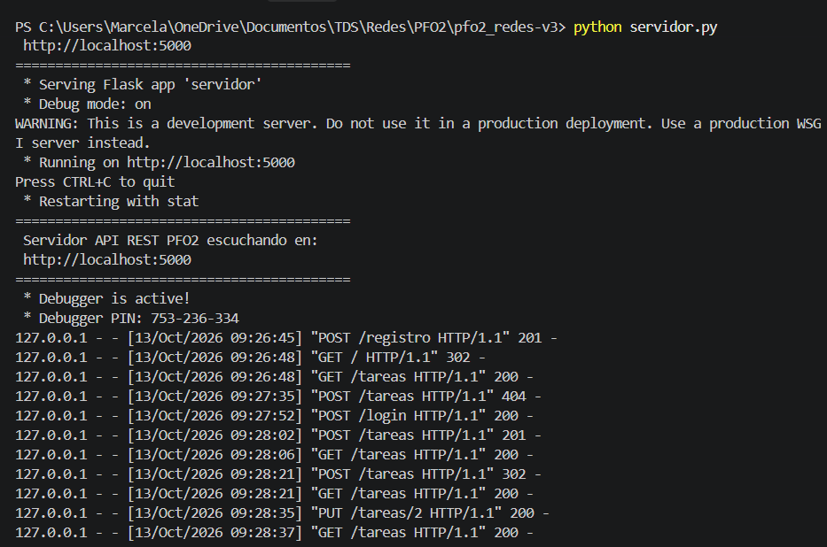
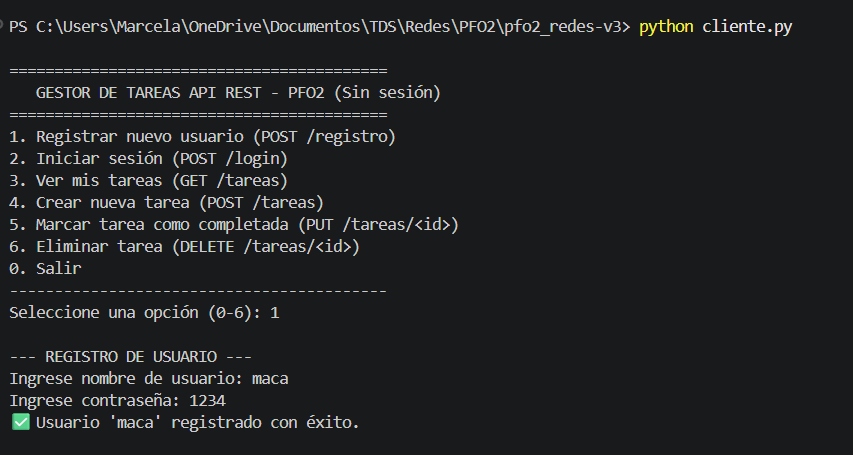
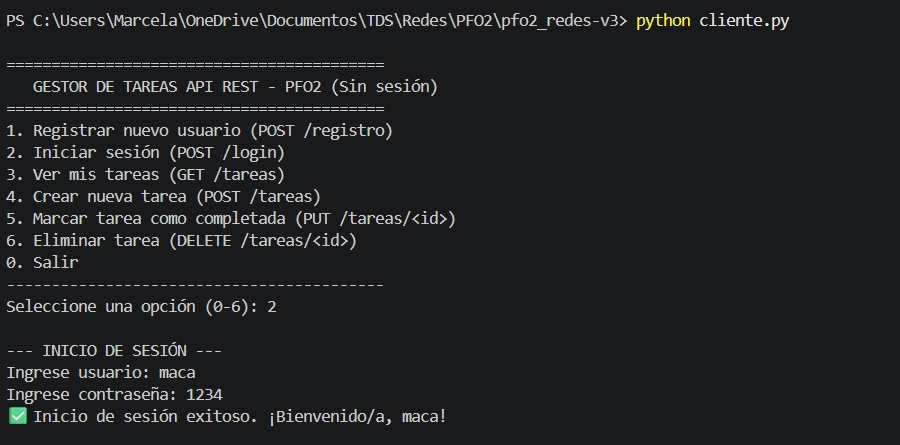
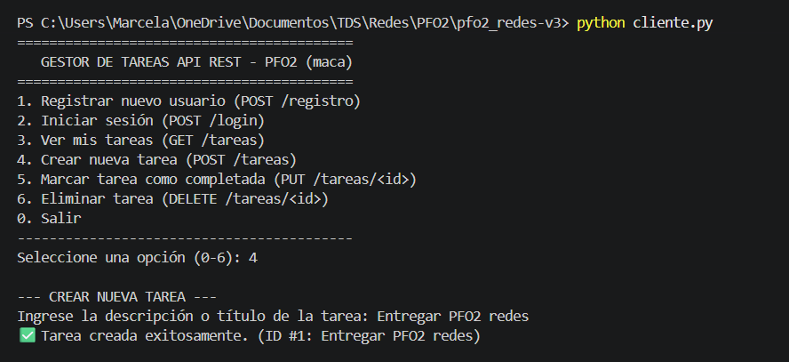
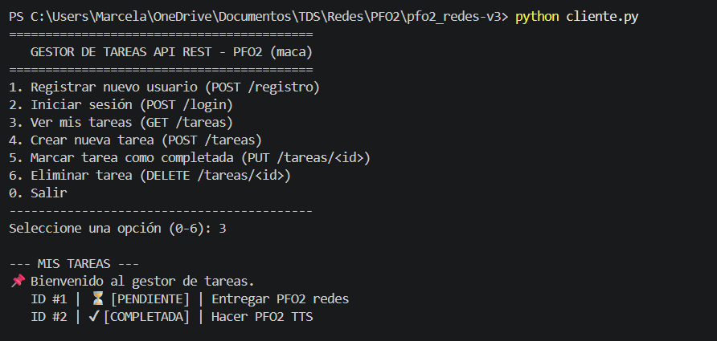
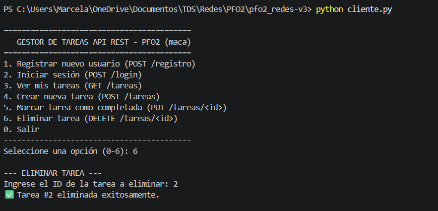
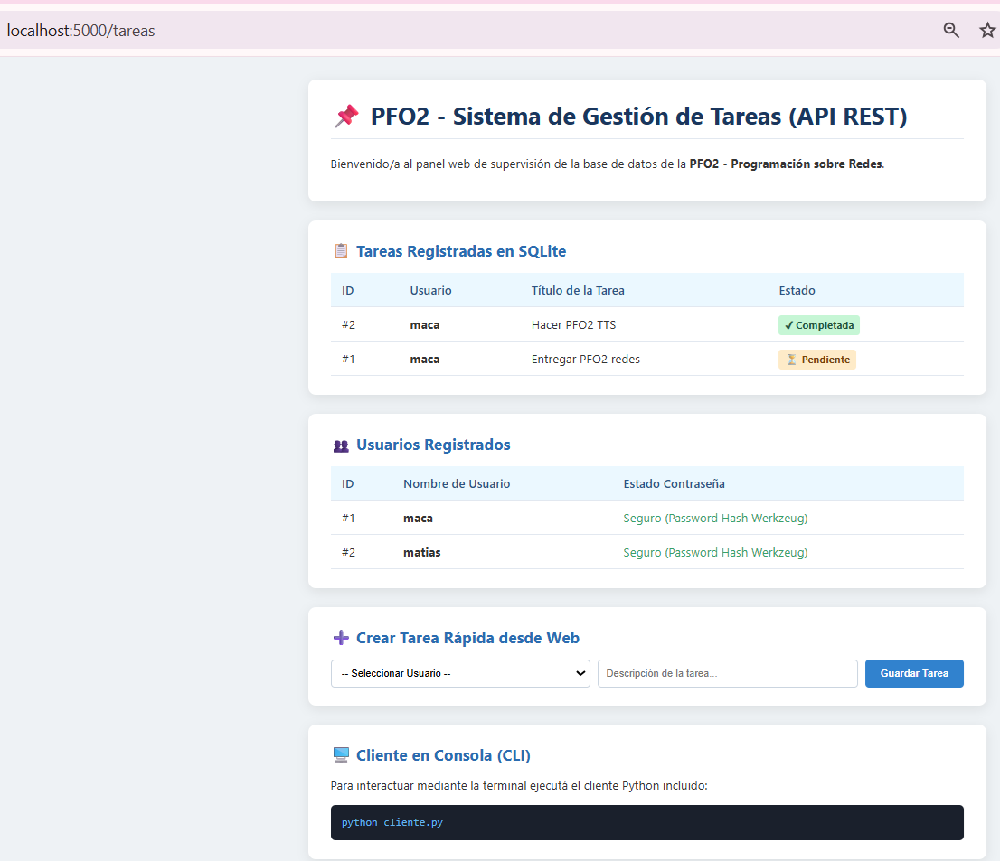

# Práctica Formativa Obligatoria 2 (PFO2)
## Sistema de Gestión de Tareas con API REST, Autenticación y SQLite

**Materia:** Programación sobre Redes  
**Profesor:** Alan Portillo  
**Entregable:** Aplicación Cliente-Servidor (API REST + Cliente Consola) en archivo `.ZIP`

---

## 📋 Descripción del Proyecto

Este proyecto implementa una arquitectura **Cliente-Servidor** completa basada en el estilo de arquitectura **REST**:
1. **Servidor API REST (`servidor.py`)**: Desarrollado en Python con **Flask** y persistencia en **SQLite**. Administra el registro de usuarios con almacenamiento seguro de contraseñas mediante **hashing**, autenticación de credenciales y gestión CRUD de tareas.
2. **Cliente de Consola (`cliente.py`)**: Interfaz en línea de comandos (CLI) que permite interactuar con la API de forma interactiva enviando peticiones HTTP (GET, POST, PUT, DELETE) con payloads en formato **JSON**.

---

## 📁 Estructura del Archivo `.ZIP`

```text
pfo2_redes.zip
├── servidor.py          # Código del servidor Flask API REST + SQLite
├── cliente.py           # Cliente interactivo en consola
├── README.md            # Documentación completa, respuestas teóricas y capturas
├── capturas/            # Carpeta para las imágenes/capturas de pantalla de prueba
│   ├── 01_servidor.png
│   ├── 02_registro.png
│   ├── 03_login.png
│   └── ...
└── pfo2_tareas.db       # Base de datos SQLite (se genera automáticamente)
```

---

## ⚙️ Requisitos de Instalación

- **Python 3.8+**
- Biblioteca `Flask` (única dependencia externa para el servidor):
  ```bash
  pip install flask
  ```
*(Nota: El cliente utiliza la librería estándar `urllib.request`, por lo que no requiere dependencias adicionales).*

---

## 🚀 Guía de Ejecución y Pruebas

Para probar el sistema, abra **dos terminales de consola independientes**:

### 1. Iniciar el Servidor API (`servidor.py`)
En la primera terminal, ejecute:
```bash
python servidor.py
```
*El servidor creará la base de datos `pfo2_tareas.db` automáticamente si no existe y quedará escuchando en `http://localhost:5000`.*

### 2. Iniciar el Cliente en Consola (`cliente.py`)
En la segunda terminal, ejecute:
```bash
python cliente.py
```
*Aparecerá un menú interactivo con las siguientes opciones:*

```text
==========================================
   GESTOR DE TAREAS API REST - PFO2 (Sin sesión)
==========================================
1. Registrar nuevo usuario (POST /registro)
2. Iniciar sesión (POST /login)
3. Ver mis tareas (GET /tareas)
4. Crear nueva tarea (POST /tareas)
5. Marcar tarea como completada (PUT /tareas/<id>)
6. Eliminar tarea (DELETE /tareas/<id>)
0. Salir
------------------------------------------
```

---

## 🔌 Especificación de Endpoints de la API REST

| Método | Endpoint | Descripción | Payload / Parámetros |
| :--- | :--- | :--- | :--- |
| `POST` | `/registro` | Registra un usuario con contraseña hasheada | `{"usuario": "luis", "contraseña": "1234"}` |
| `POST` | `/login` | Verifica credenciales contra el hash | `{"usuario": "luis", "contraseña": "1234"}` |
| `GET` | `/tareas` | Lista tareas (filtradas o generales) | `?usuario=luis` (opcional) |
| `POST` | `/tareas` | Crea una nueva tarea para un usuario | `{"usuario": "luis", "titulo": "Estudiar para el examen"}` |
| `PUT` | `/tareas/<id>` | Marca una tarea como completada | URL param: `id` de la tarea |
| `DELETE` | `/tareas/<id>` | Elimina una tarea existente | URL param: `id` de la tarea |

---

## 📸 Capturas de Pantalla / Evidencia de Funcionamiento

*(Guarde sus capturas de pantalla dentro de la carpeta `capturas/` con los siguientes nombres recomendados o actualice las rutas si prefiere otros nombres):*

1. **Servidor API en Ejecución (`servidor.py`)**:  
   

2. **Registro de Usuario (`POST /registro`)**:  
   

3. **Inicio de Sesión y Autenticación (`POST /login`)**:  
   

4. **Creación de Tarea (`POST /tareas`)**:  
   

5. **Listado de Tareas en Consola (`GET /tareas`)**:  
   

6. **Completar y Eliminar Tareas (`PUT` / `DELETE`)**:  
   

7. **Vista de Bienvenida HTML desde Navegador (`GET /tareas`)**:  
   

---

## 🧠 Respuestas a las Preguntas Conceptuales

### 1. ¿Por qué es fundamental hashear contraseñas en el servidor?
- **Protección ante filtraciones de Base de Datos:** Si un atacante o tercero no autorizado obtiene acceso al archivo de la base de datos (`pfo2_tareas.db`), nunca podrá conocer las contraseñas reales de los usuarios, ya que la función de hash es de una sola vía (irreversible).
- **Prevención del reúso de credenciales:** Los usuarios suelen reutilizar contraseñas en múltiples servicios. Al almacenar únicamente el hash (usando algoritmos seguros como `pbkdf2:sha256` o `bcrypt` con *salt* incorporado), se evita comprometer la seguridad del usuario en otras plataformas.
- **Irreversibilidad matemática:** A diferencia del cifrado simétrico/asimétrico (que puede desencriptarse con una clave), un hash seguro no se puede revertir linealmente, protegiendo las credenciales incluso frente a administradores del sistema.

### 2. Ventajas de utilizar SQLite en este proyecto
- **Zero-Configuration & Portabilidad:** SQLite es una base de datos relacional basada en un único archivo plano sin necesidad de instalar, configurar ni administrar un servicio o demonio externo (como MySQL o PostgreSQL).
- **Integración Nativa en Python:** La librería `sqlite3` está incluida directamente en la biblioteca estándar de Python, garantizando la ejecución inmediata del servidor sin instalar controladores de base de datos adicionales.
- **Sustento del Modelo Relacional:** A pesar de su ligereza, SQLite es un motor SQL completo que soporta claves primarias, claves foráneas (`FOREIGN KEY`), transacciones ACID e integridad de datos.
- **Ideal para Entornos de Desarrollo y Prototipado:** Permite empaquetar el proyecto completo en un archivo comprimido `.ZIP` manteniendo la persistencia de datos accesible y verificable de forma local.
